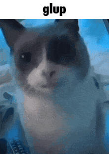

# caption

Fast image and GIF captioning. Utilizes [Cosmic Text](https://github.com/pop-os/cosmic-text)
for font rendering, and [quantette](https://docs.rs/quantette/latest/quantette/) for an implementation of Wu Quantization algorithm.



## Usage

```
caption-image -i image.png -t "hello world"
caption-image -i image.gif -t "hello world"
```

## Library

For both Python and Rust, a `Captioner` object is created and used to caption
images. This object should be reused to keep font caches alive.

### Rust

```rust
use caption::{Captioner, OutputFormat};

let mut c = Captioner::new();
let data = include_bytes!("tests/fixtures/sources/static_500x500.png");

let out = c.caption_bytes(data, "hello world", OutputFormat::Same).unwrap();
assert!(!out.is_empty());
```

bytes to bytes only!

### Python

Create a `Captioner` and pass bytes in:

```python
from pathlib import Path

import caption

captioner = caption.Captioner()
data = Path("image.gif").read_bytes()
out = captioner.caption_bytes(data, "hello world", "webp")
Path("captioned.webp").write_bytes(out)
```
